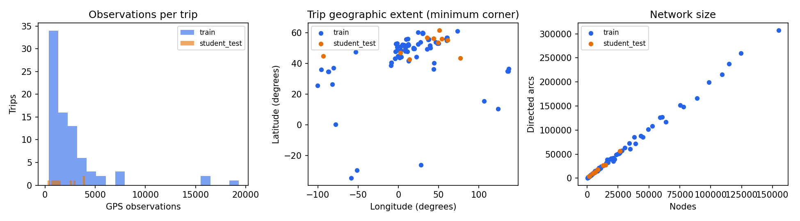
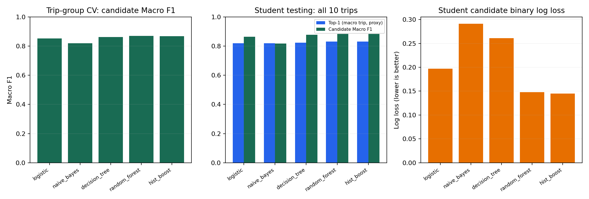
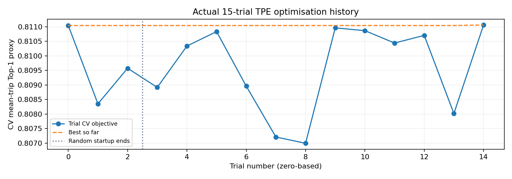
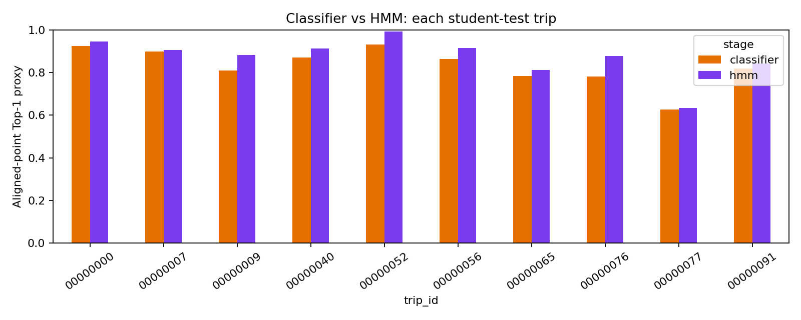
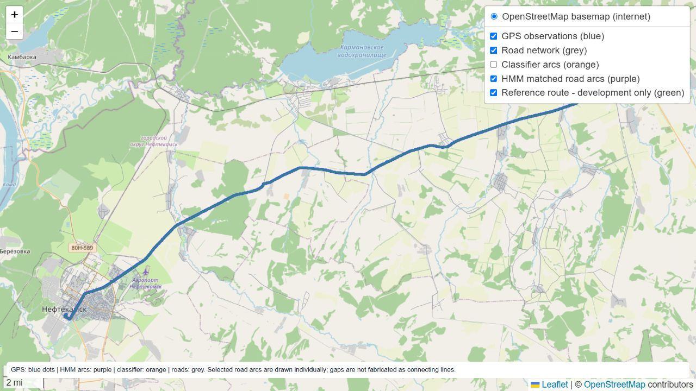
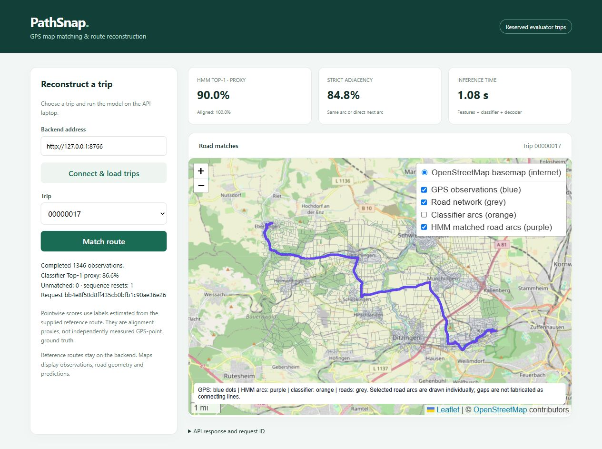
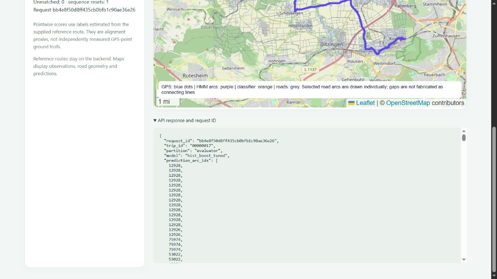
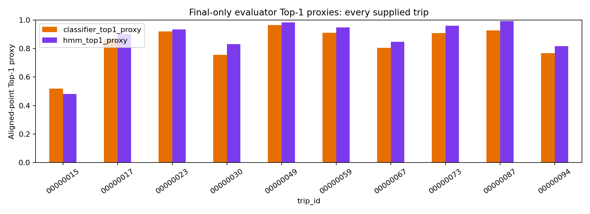

# PathSnap: technical report

Generated from executed artifacts on 2026-11-18 07:40 UTC.

**AI-assisted technical report, for team review. Actual development and final-only backend evaluations were executed. A physical second-laptop rehearsal and receiving-terminal screenshot remain team handoff tasks.** Team member details and independent review must be added before submission.

## 1. Requirements and experimental scope

Both original ZIP archives and all five guideline PDFs were inspected. The assignment requires five trained models, group-aware evaluation and Bayesian optimisation, HMM/Viterbi comparison, Folium maps, a FastAPI/UI split across two laptops, a public source repository and one PDF. Exact requirement-to-page links are retained in docs/REQUIREMENTS.md. The evaluator ZIP was supplied later, kept separate, and imported only after the model/configuration/source freeze.

The experiment uses all 80 training trips and all 10 student-test trips. Five models use the same three GroupKFold splits. Fitting samples every fifth observation per training trip; validation and student testing use all observations. This is an initial benchmark, not the full-observation fitting ablation. The same candidate rows belonging to an observation stay together, and all observations from a trip stay in one fold.

## 2. Dataset understanding and exploration

| Partition | Trips | GPS rows | Gaps >30 s | Reference breaks |
| --- | --- | --- | --- | --- |
| train | 80 | 208417 | 133 | 13 |
| student_test | 10 | 19160 | 2 | 1 |

All supplied GPS numeric cells are finite and all timestamps increase strictly. Training intervals are 1 s for 96.50% of steps; the maximum gap is 153064.0 s. Student-test maximum gap is 210.0 s. Connectivity, geographic extents, file sizes, hashes and sampling statistics are recorded per trip in artifacts/eda/trip_inventory.csv. Component counts describe each trip-specific network, not a unique global map.

Zero-length arcs: 100 across training network files and 6 across student-test files. No isolated nodes were found. Zero-length geometry is numerically guarded; routing uses a tiny positive edge weight rather than inventing length. Reference breaks mean consecutive supplied route arcs do not share the expected directed endpoint.

### Preprocessing, reference alignment and limitations

Headerless whitespace tables are parsed strictly: track=[longitude, latitude, seconds], nodes=[longitude, latitude], arcs=[from node row ID, to node row ID], route=[arc row ID]. IDs are zero-based. Invalid coordinates, invalid IDs, non-finite data and non-increasing timestamps fail explicitly. Data is not silently reordered, imputed or snapped to a reference.

Distances use a per-trip UTM projection with longitude/latitude axis order explicit. Road geometry is the straight segment between supplied endpoints; the files do not provide speed limits or detailed curved polylines. An exact STRtree radius query generates up to eight candidates within 60 m, sorted by distance then ID. No nearest-road fallback is fabricated for empty sets.

The supplied route is an ordered list of traversed arcs, not a label for each GPS row. Offline alignment minimizes cumulative squared point-to-segment distance over non-decreasing reference route positions: D[t,j] = distance(t,j)^2 + min(D[t-1,h] for h<=j). Repeated arc IDs remain distinct occurrences. States can stay or advance; endpoints are not forced. Residuals above 100 m are unknown. This geometric weak supervision can bias results toward geometry and misalign loops/stops/disconnected references. It is not independently measured point truth or an organiser-specified scorer.

| Partition | Aligned GPS rows | Label coverage | Candidate misses* | No candidates |
| --- | --- | --- | --- | --- |
| train | 187879 | 90.15% | 3958 | 17492 |
| student_test | 19143 | 99.91% | 55 | 0 |

*Candidate misses use only aligned observations. Missing candidate sets and absent reference candidates count as Top-1 errors on eligible rows; unknown-reference rows are excluded and coverage is shown. Train trip 00000054 has 19,313 points, only 2,858 usable aligned labels, and 16,178 empty candidate sets at the initial radius. It remains in the inventory and folds. This issue warrants candidate-radius and alignment sensitivity experiments; its physical cause has not been established.

### Features

The 12 features are distance in metres, heading cosine, heading-known flag, log segment length, projected fraction, capped GPS speed, capped previous sampling interval, capped GPS step length, distance rank, candidate count, and outdegree of the two endpoints. Heading uses the previous observation only when movement is at least 3 m and the time interval is at most 30 s. First/stationary/gap observations use neutral heading with the flag unset. IDs, absolute coordinates, reference membership and aligned-label information are not features. Logistic scaling is fitted inside each training fold.

## 3. Model experimentation and comparison

Candidate binary Macro F1 averages positive and negative candidate classes; binary log loss uses the raw probability of candidate correctness. Observation Top-1 selects the highest-scoring available candidate. Top-1 metrics are reference-alignment proxies. The primary selection metric is validation Top-1 averaged equally across trips, then averaged across folds. Student testing is development-stage evidence, not an untouched final benchmark. No model selection uses evaluator data.

| Model | CV Macro F1 | CV Top-1 proxy | CV fold SD |
| --- | --- | --- | --- |
| logistic | 0.8515 | 0.7990 | 0.0267 |
| naive_bayes | 0.8187 | 0.7988 | 0.0267 |
| decision_tree | 0.8615 | 0.7981 | 0.0253 |
| random_forest | 0.8688 | 0.8093 | 0.0267 |
| hist_boost | 0.8680 | 0.8101 | 0.0264 |

| Model | Student Macro F1 | Student Top-1 proxy* | Log loss |
| --- | --- | --- | --- |
| logistic | 0.8643 | 0.8202 | 0.1969 |
| naive_bayes | 0.8174 | 0.8199 | 0.2910 |
| decision_tree | 0.8770 | 0.8236 | 0.2610 |
| random_forest | 0.8831 | 0.8299 | 0.1477 |
| hist_boost | 0.8837 | 0.8305 | 0.1447 |

*Student Top-1 here is an equal-trip average. The comparison CSV also retains the pooled observation average. Fold SD is descriptive variability across three folds, not a confidence interval.

| Model | Refit seconds | Student scoring seconds** |
| --- | --- | --- |
| logistic | 0.557 | 0.178 |
| naive_bayes | 0.105 | 0.353 |
| decision_tree | 6.026 | 0.170 |
| random_forest | 87.815 | 4.582 |
| hist_boost | 9.889 | 5.358 |

**Scoring routine timing includes candidate probability prediction, binary diagnostics and a second probability pass for binary metrics on precomputed features. It excludes raw parsing, projection, candidate generation, HMM, map generation and network latency. End-to-end HTTP timing belongs to a separate deployment test. These are measured wall times on this host, not hardware-independent latency promises.

### Classifier-only route diagnostics

| Model | Strict adjacency | Arc-set F1 | Sampled edit | Inference s/trip |
| --- | --- | --- | --- | --- |
| decision_tree | 0.8876 | 0.7947 | 0.4425 | 0.0041 |
| hist_boost | 0.8974 | 0.7974 | 0.4518 | 0.2225 |
| logistic | 0.8874 | 0.7835 | 0.4366 | 0.0076 |
| naive_bayes | 0.8851 | 0.7808 | 0.4364 | 0.0115 |
| random_forest | 0.8963 | 0.7986 | 0.4517 | 0.2213 |

These are equal-trip averages across all ten student-test trips, using classifier-only predictions. Strict adjacency means consecutive non-gap observations select the same or directly adjoining directed arcs; unmatched pairs count as failures. It can penalize valid multi-arc travel between samples. Arc-set F1 ignores order. Sampled edit similarity compares collapsed predicted arcs with the supplied reference sequence and can penalize unsampled intermediate roads. Inference here is a single classifier pass and argmax on prepared candidates; it excludes preprocessing, HMM and maps. HMM results are reported separately in section 5.

Run settings: seed 42, training candidate rows used for fitting: 226467. Selected untuned model: hist_boost. Full parameters, versions and metrics are in artifacts/experiment_run.json; exact fold trip membership is in artifacts/cv_splits.json.

Training-partition scores below use all eligible observations, including rows not sampled for fitting; they are not pure resubstitution scores.

### logistic: Linear probabilistic baseline

Scaled logistic negative log likelihood with L2 regularisation; initial C=1 and max_iter=500. Interpretable and inexpensive; a linear boundary cannot express every interaction between distance, heading and junction structure.

Measured candidate Macro F1: training partition 0.8524, held-out-trip CV 0.8515, student test 0.8643. Training-minus-CV gap is +0.0008. This comparison alone does not establish substantial overfitting or underfitting; inspect trip-level errors and label quality.

Student Top-1 proxy (macro trip) 0.8202, candidate Macro precision 0.8749, recall 0.8546, log loss 0.1969. Confusion matrix (rows=true [0,1], columns=predicted [0,1]): [[96864, 3608], [4866, 14222]].

### naive_bayes: Gaussian probabilistic baseline

Class-conditional Gaussian likelihood and empirical priors; var_smoothing=1e-9. Fast likelihood baseline; distance/rank and motion features violate conditional independence and can produce overconfident probabilities.

Measured candidate Macro F1: training partition 0.8206, held-out-trip CV 0.8187, student test 0.8174. Training-minus-CV gap is +0.0019. This comparison alone does not establish substantial overfitting or underfitting; inspect trip-level errors and label quality.

Student Top-1 proxy (macro trip) 0.8199, candidate Macro precision 0.7876, recall 0.8658, log loss 0.2910. Confusion matrix (rows=true [0,1], columns=predicted [0,1]): [[90269, 10203], [3183, 15905]].

### decision_tree: Single nonlinear tree

Gini impurity split criterion; max_depth=12, min_samples_leaf=20. Readable nonlinear rules; a single tree can vary substantially with weak-label noise and its piecewise probabilities can harm log loss.

Measured candidate Macro F1: training partition 0.8731, held-out-trip CV 0.8615, student test 0.8770. Training-minus-CV gap is +0.0116. This comparison alone does not establish substantial overfitting or underfitting; inspect trip-level errors and label quality.

Student Top-1 proxy (macro trip) 0.8236, candidate Macro precision 0.8826, recall 0.8717, log loss 0.2610. Confusion matrix (rows=true [0,1], columns=predicted [0,1]): [[96915, 3557], [4221, 14867]].

### random_forest: Bagged tree ensemble

80 trees using Gini splits, max_depth=16, min_samples_leaf=10, max_features=sqrt, one worker. Averages nonlinear rules and reduces tree variance; more storage and compute than the linear baselines, with no guarantee of well-calibrated probabilities.

Measured candidate Macro F1: training partition 0.8864, held-out-trip CV 0.8688, student test 0.8831. Training-minus-CV gap is +0.0176. This comparison alone does not establish substantial overfitting or underfitting; inspect trip-level errors and label quality.

Student Top-1 proxy (macro trip) 0.8299, candidate Macro precision 0.8979, recall 0.8699, log loss 0.1477. Confusion matrix (rows=true [0,1], columns=predicted [0,1]): [[97663, 2809], [4433, 14655]].

### hist_boost: Histogram gradient boosting

Binary log loss; 100 iterations, 31 leaves, learning_rate=0.1, l2_regularization=1, min_samples_leaf=30; early stopping disabled. Learns feature interactions efficiently; can fit weak-label artefacts and requires independent validation rather than trusting training fit.

Measured candidate Macro F1: training partition 0.8871, held-out-trip CV 0.8680, student test 0.8837. Training-minus-CV gap is +0.0191. This comparison alone does not establish substantial overfitting or underfitting; inspect trip-level errors and label quality.

Student Top-1 proxy (macro trip) 0.8305, candidate Macro precision 0.8937, recall 0.8746, log loss 0.1447. Confusion matrix (rows=true [0,1], columns=predicted [0,1]): [[97396, 3076], [4204, 14884]].

## 4. Bayesian hyperparameter optimisation

Optuna TPE evaluated 15 configurations: 3 random startup trials and 12 subsequent adaptive trials. Objective: the same training-trip CV macro-trip Top-1 proxy as initial selection. No student labels enter the objective. The trial record is retained in artifacts/optimization_trials.csv and optimization.sqlite3. The search implementation and ranges are in src/pathsnap/models.py (search_space).

Best parameters: {"max_iter": 100, "max_leaf_nodes": 63, "learning_rate": 0.048015180105304096, "l2_regularization": 0.3890112181435344, "min_samples_leaf": 15}. Search wall time: 433.88 s; best-trial refit: 4.90 s.

HGB search space: max_iter integer 60-160 in steps of 20; max_leaf_nodes integer 7-63; learning_rate log-uniform 0.02-0.25; l2_regularization log-uniform 0.01-20; min_samples_leaf log-scaled integer 10-100. These ranges vary iteration budget, tree complexity, update size and regularisation. They were fixed before final evaluator import.

| Configuration | CV Macro F1 | CV Top-1 proxy | Student F1 | Student Top-1 proxy | Log loss |
| --- | --- | --- | --- | --- | --- |
| Untuned | 0.8680 | 0.8101 | 0.8837 | 0.8305 | 0.1447 |
| Tuned | 0.8685 | 0.8111 | 0.8839 | 0.8306 | 0.1456 |

Tuned student scoring routine time: 2.349 s. The tuned model was selected because it improved the training-trip CV selection objective. A best-of-trials CV score is selection-biased; it is not nested CV or a final generalisation estimate. More trials and multiple seeds remain useful follow-ups.

## 5. HMM, Viterbi and route reconstruction

Hidden states are candidate directed arc IDs at each observation. Emission potentials are the selected classifier binary scores normalized over that observation's candidates, floored for numerical stability. This is a discriminative HMM-style decoder, not a calibrated generative sensor model. Transition distance combines the remaining previous arc, a directed shortest path between endpoint nodes and the next arc's projected prefix. Staying on the same directed arc allows up to 5 m of projection jitter. Feasibility requires road distance <= 60 m/s * elapsed seconds + 30 m.

Feasible transition potentials exp(-abs(road_distance - GPS_displacement)/30 m) are row-normalized over next candidates. Viterbi maximizes log emission plus previous score plus log transition, retaining a backpointer for every candidate. It backtracks each uninterrupted block. Gaps over 30 s, empty sets, and steps with no feasible transition restart decoding explicitly; empty sets return -1. Directed shortest paths fill intermediate arcs within route parts; disconnected/reset parts stay separate.

Strict adjacency counts non-gap consecutive observations assigned to the same arc or directly adjoining arcs, including unmatched pairs as failures. It is deliberately stricter than network reachability and can penalize valid multi-arc motion between observations. Arc-set F1 ignores order; sampled-arc edit similarity preserves order after collapsing repeated predictions but penalizes intermediate roads without GPS samples. These diagnostics are not independent physical ground truth.

| Stage | Top-1 proxy* | Strict adjacency* | Arc-set F1* | Sampled edit* |
| --- | --- | --- | --- | --- |
| classifier | 0.8306 | 0.8995 | 0.7980 | 0.4537 |
| hmm | 0.8719 | 0.9608 | 0.8839 | 0.6840 |

*Equal-trip averages across student-test trips. Per-trip rows, candidate misses, resets and score/decode timings are in artifacts/route_evaluation.csv. Score/decode timing excludes raw input/feature generation and map rendering.

HMM Top-1 proxy improved on 10 trips, worsened on 0 trips and tied on 0 trips. The mean change was +0.0413; an improvement in continuity does not imply an improvement in pointwise agreement.

## 6. Folium geographical visualisation

The offline map in artifacts/maps/00000000.html is generated from actual input and predictions, with blue GPS dots, grey road geometry, green development reference arcs, orange classifier arcs and purple reconstructed HMM arcs. Layer controls and fit bounds support comparison. Predicted road segments are drawn individually; route breaks are not joined with invented straight lines. API maps omit reference layers.

## 7. API, frontend and deployment

FastAPI exposes GET /health, GET /trips, POST /match and a reference-free map route. The frontend runs separately and sends a selected trip ID. Backend inference accepts only track, nodes and arcs; scoring opens the reference after prediction completes. Request IDs and measured stage times are returned and logged. Missing models return 503, unknown IDs 404, invalid input 422, and concurrent inference 429. The browser origin is explicitly permitted through CORS. No predictions are hardcoded.

The demo runbook explains the two-laptop LAN address, localhost distinction, firewall/CORS checks, evaluator-only directory and genuine evidence capture. Leaflet JS/CSS/images are self-hosted; only optional basemap tiles need internet. The backend serves the UI at /ui/ and binds an exclusive Windows socket on port 8766 to avoid sharing a port with another local service. The evaluator directory is separate from all development loaders.

Local loopback HTTP smoke test recorded 10 trips and 10 successful HTTP 200 responses. Each response length matched the input GPS count, and each served map was checked for absence of a reference layer. Scope: local loopback HTTP; not a physical two-laptop demo. Receipt: artifacts/api_smoke.json; server logs: artifacts/development_backend.log.

Automated test receipt: {"command": "python -m pytest -q", "passed": 14, "failed": 0, "warnings": 1, "log": "artifacts/final_tests.log"}. Tests cover segment geometry, missing candidates and denominator handling, monotone labels, graph direction, resets, intermediate road reconstruction and API reference separation.

### Final-only evaluator results after model freeze

All ten evaluator trips were inferred through the HTTP backend after the model/source freeze. References were used only for server-side scoring after prediction; final outcomes were not used for model selection, hyperparameters, candidate settings or decoder choices.

| Trip | GPS rows | Classifier Top-1 | HMM Top-1 | Coverage | HTTP s |
| --- | --- | --- | --- | --- | --- |
| 00000015 | 6854 | 0.5181 | 0.4803 | 1.0000 | 8.184 |
| 00000017 | 1346 | 0.8663 | 0.9004 | 1.0000 | 3.522 |
| 00000023 | 458 | 0.9192 | 0.9345 | 1.0000 | 0.754 |
| 00000030 | 654 | 0.7554 | 0.8303 | 1.0000 | 1.366 |
| 00000049 | 2642 | 0.9644 | 0.9830 | 1.0000 | 4.302 |
| 00000059 | 1031 | 0.9108 | 0.9467 | 1.0000 | 1.903 |
| 00000067 | 916 | 0.8057 | 0.8461 | 1.0000 | 1.313 |
| 00000073 | 1144 | 0.9073 | 0.9598 | 1.0000 | 1.763 |
| 00000087 | 1399 | 0.9264 | 0.9921 | 1.0000 | 4.000 |
| 00000094 | 3230 | 0.7675 | 0.8161 | 1.0000 | 4.946 |

All Top-1 values in this table are reference-alignment proxies. Final evaluation covered 19674 observations. Equal-trip HMM Top-1 proxy is 0.8689; pooled observation HMM Top-1 proxy is 0.7596. These differ because trip lengths and difficulty differ. The 6,854-point trip 00000015 is weaker (HMM proxy 0.4803) and remains included. Its cause has not been established and no final-data-driven changes were made.

Final strict adjacency (equal-trip average) is 0.8949 classifier-only and 0.9426 after HMM. Mean/max HTTP times are 3.205/8.184 s on this host; physical network latency on Laptop 2 was not measured. All ten returned HTTP 200 with valid output lengths/arc IDs, connected reconstructed parts and reference-free maps.

Model frozen at 2026-11-18T07:15:26.136400+00:00; SHA-256 5cb6500bf65c7edb28b71592fc7243e1a00329683317d8f0a14cbb883e173f11. Runtime checks require this model and its inference-source hashes to match. The import receipt timestamps the later evaluator provisioning. Evidence: artifacts/final/model_manifest.json, development_verification.json, evaluator_api_smoke.json, evaluator_results.csv and final_summary.json; private input hashes remain under data/evaluation_server/.

The backend health endpoint was reached through both loopback and its own Wi-Fi address 10.1.24.198:8766. The final Jupyter notebook executed with real backend responses and saved outputs. These same-host checks are distinct from a physical second-laptop rehearsal. Actual receiving-terminal and second-laptop screenshots remain to be captured by the team; a browser API screenshot is not represented as terminal evidence.

## 8. Limits and work before submission

Confirm the official scoring convention and point-label availability. Investigate weak-label errors, candidate-radius/cap sensitivity, stops/loops and reset-heavy trips. Repeat fitting at stride 1 and consider geographic holdout and multiple seeds. The current trip split does not guarantee unseen roads. TPE uses the same CV folds for selection, not nested CV. No calibration experiment is claimed. Unknown-reference rows are not silently scored as correct.

Complete a physical two-laptop rehearsal using the supplied ten choices. Capture the actual receiving-laptop terminal and second-laptop UI. Add team/member details, independently verify interpretations and disclose assistance as required. Publish the source and trusted model/configuration to the team's chosen public repository. The source/frontend release archives are supplied; this task did not publish a repository or claim a physical second-laptop demonstration.

## 9. Provenance and references

| Archive | SHA-256 | Files |
| --- | --- | --- |
| Student folder.zip | 4804b0399d1d56f4844b9c74e2f998aae0a281fb5947a1f47ad1bd013214d248 | 360 |
| PathSnap_student_materials.zip | db368793f68c76baa8eaa30d783d376df50841287c29c43f6911feb98cab4367 | 5 |

Assignment sources: Main Guidelines p.2; Dataset Exploration pp.1-4; Models and Training Guidelines pp.1-6; Deliverables pp.1-7; Assessment and Plagiarism Policy pp.1-3. The originals and page-bounded extractions were inspected; see docs/REQUIREMENTS.md for the claim-by-claim map.

External primary sources: [Newson and Krumm (2009)](https://www.microsoft.com/en-us/research/publication/hidden-markov-map-matching-noise-sparseness/); [scikit-learn GroupKFold](https://scikit-learn.org/stable/modules/generated/sklearn.model_selection.GroupKFold.html); [Shapely STRtree](https://shapely.readthedocs.io/en/stable/strtree.html); [Optuna TPESampler](https://optuna.readthedocs.io/en/stable/reference/samplers/generated/optuna.samplers.TPESampler.html); [FastAPI CORS](https://fastapi.tiangolo.com/tutorial/cors/); [Folium user guide](https://python-visualization.github.io/folium/latest/user_guide.html). These support design explanations, not the project's measured performance. See docs/SOURCES.md for source scope.
